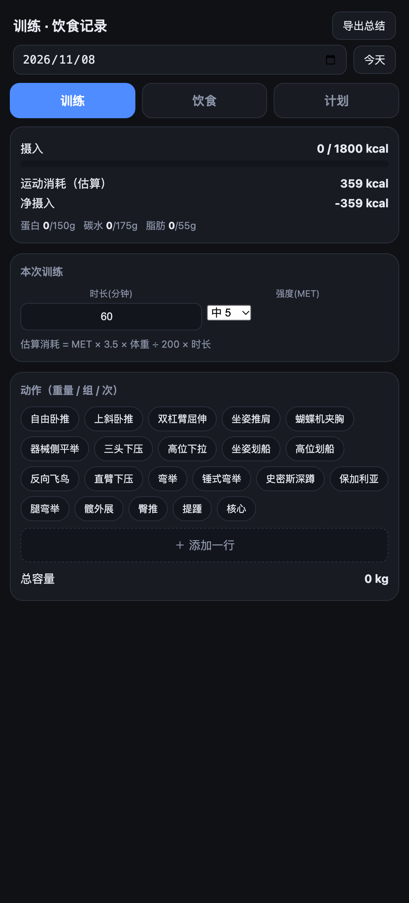
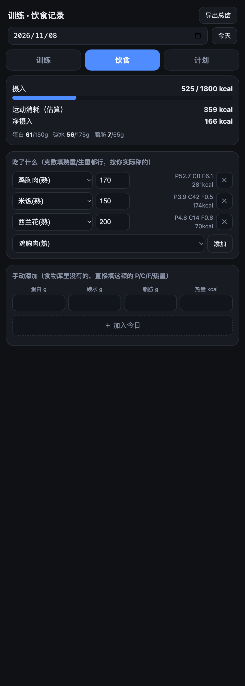
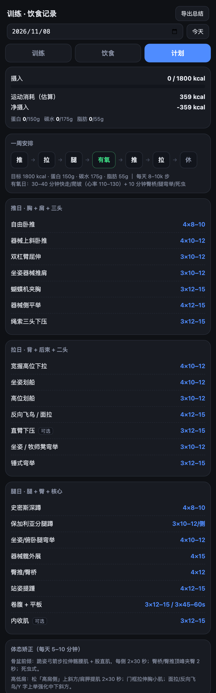

# 训练饮食记录 · Train & Diet Tracker

一个面向减脂期的 **PPL 训练 + 饮食记录** 工具。纯前端、零依赖、可离线，装到手机主屏就能当 App 用。

<p align="center">
  
  
  
</p>

## 为什么做这个

减脂期要同时盯三件事：训练有没有保住肌肉、饮食有没有吃够蛋白 / 控住热量、体态有没有改善。市面上的健身 App 要么太重，要么不能自定义目标，于是自己写了一个轻量的单页应用——打开就记、自动算数、断网可用。

## 功能

### 训练
- 按周计划记录：**推 → 拉 → 腿 → 有氧 → 推 → 拉 → 休**
- 每个动作填重量 / 组 / 次数，自动计算训练容量
- 按 MET 估算本次训练的热量消耗

### 饮食
- 内置 20+ 常见食物营养库（每 100g 蛋白质 / 碳水 / 脂肪 / 热量）
- 输入克数自动换算，实时汇总当天摄入
- 与每日目标（1800 kcal / 蛋白 150g / 碳水 175g / 脂肪 55g）对比
- 支持手动添加食物库里没有的食物

### 其他
- **一键导出**当天记录为文本，方便交给 AI 做进一步分析
- **PWA**：可添加到手机主屏，Service Worker 离线缓存，断网也能打开
- **数据本地化**：全部保存在浏览器 `localStorage`，不上传任何服务器
- 按日期分桶存储，可回看历史

## 技术栈

| 层 | 选型 |
|---|---|
| 前端 | 原生 HTML / CSS / JavaScript（无框架、无构建步骤） |
| 离线 | PWA：`manifest.json` + Service Worker（缓存优先） |
| 存储 | `localStorage`（按日期分桶） |
| 部署 | 腾讯云 CloudBase 静态网站托管 |

## 项目结构

```
.
├── index.html            # 单页应用：UI + 全部逻辑（训练 / 饮食 / 计划）
├── sw.js                 # Service Worker：离线缓存
├── manifest.json         # PWA 清单
├── icon-192.png          # 主屏图标
├── icon-512.png
├── apple-touch-icon.png
└── screenshots/          # README 截图
```

## 本地运行

没有任何依赖，直接用浏览器打开 `index.html` 即可；或者起一个静态服务器：

```bash
python3 -m http.server 8000
# 浏览器打开 http://localhost:8000
```

> PWA / 离线缓存需要 HTTPS 或 localhost 环境。

## 部署

把目录内所有文件上传到任意静态托管即可。本项目使用腾讯云 CloudBase 静态网站托管（默认域名免备案、大陆直连）。

## 说明

营养数据与热量消耗均为估算值，仅供参考，不构成医疗建议。

## License

[MIT](LICENSE)
